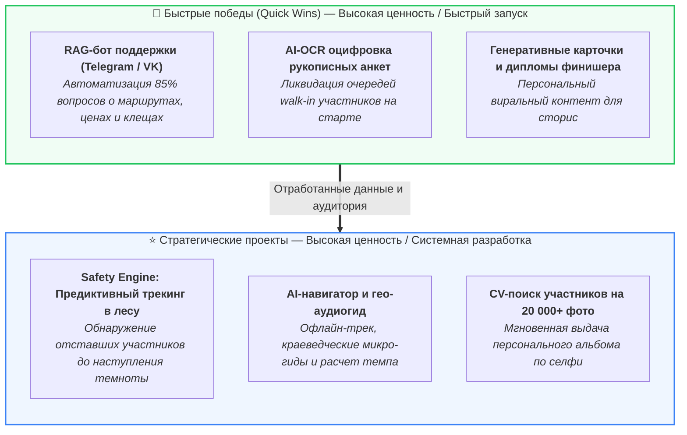

# Внедрение технологий Искусственного Интеллекта (ИИ) в экосистему «Майская прогулка»

> **Примечание:** Документ содержит практические сценарии применения прикладного ИИ (Computer Vision, NLP/LLM, Predictive ML) для решения реальных проблем организаторов (безопасность людей в лесу, разгрузка волонтеров) и участников (навигация, очереди, вовлеченность).

---

## 1. Матрица приоритетов внедрения ИИ

### Сводная оценка инициатив

| Инициатива | Ценность для организатора / участника | Сложность разработки | Стек технологий | Рекомендуемый этап |
| :--- | :--- | :---: | :--- | :---: |
| **RAG-бот поддержки** | Разгрузка оргкомитета на 85% перед стартом | **Низкая** | LangChain / LlamaIndex, PGVector, Telegram/VK Bot API | **MVP (Этап 1)** |
| **AI-OCR анкет на старте** | Ликвидация очередей, сокращение волонтеров-наборщиков | **Средняя** | PaddleOCR / Yandex Vision, FastAPI, PWA | **MVP (Этап 1)** |
| **Генеративные карточки** | Виральный маркетинг в соцсетях, вау-эффект на финише | **Низкая** | Node.js Canvas / Pillow, LLM API | **MVP (Этап 1)** |
| **AI-навигатор и аудиогид** | Решение главной боли («нет навигации»), интерактивность | **Средняя** | Mapbox/Leaflet Offline, Edge-TTS, Geofencing | **Этап 2** |
| **Safety Engine (трекинг)** | Жизненно важная безопасность людей на дистанциях до 70 км | **Выше средней** | LightGBM / Anomaly Detection, WebSockets | **Этап 2** |
| **CV-поиск по фото** | Персональные фото для 10 000+ участников, спонсорский охват | **Высокая** | RetinaFace, InsightFace (ArcFace), Celery, MinIO | **Этап 3** |

---

## 2. Детальный разбор прикладных сценариев ИИ

### Сценарий 1. AI-OCR для мгновенной оцифровки рукописных анкет на старте
* **Проблема As-Is:** На старте у стадиона УрФУ сотни участников приходят без предварительной онлайн-регистрации. Они вручную заполняют бумажные бланки ручкой. Десятки волонтеров тратят часы, разбирая плохой почерк и вбивая данные в форму `regadd`. Возникают гигантские очереди, а в базе появляются ошибки в ФИО, телефонах и датах рождения.
* **Решение To-Be:**
  В интерфейс приложения волонтера интегрируется модуль оптического распознавания документов:
  1. Волонтер наводит камеру смартфона на заполненный бланк анкеты.
  2. Модель детекции документов (YOLOv8-obb / DocDetect) находит границы листа и выравнивает перспективу.
  3. OCR-движок (PaddleOCR / Yandex Vision OCR / TrOCR) считывает рукописный текст по полям: *Фамилия, Имя, Отчество, Дата рождения, Телефон, Дистанция*.
  4. Компактная языковая модель (LLM / Structured Regex Parser) исправляет опечатки, валидирует телефон и приводит город к единому справочнику (например, «екб» -> «г. Екатеринбург»).
  5. Волонтер видит на экране распознанные данные, нажимает кнопку «Подтвердить», и участнику мгновенно присваивается номер карты/браслета.
* **Архитектурный стек:** `Python`, `FastAPI`, `PaddleOCR` / `OnnxRuntime`, `Yandex Vision OCR` (как fallback).
* **Бизнес-эффект:**
  * Сокращение времени ввода одной анкеты с 90 секунд до 3–4 секунд.
  * Сокращение волонтеров на компьютерном наборе с 15–20 человек до 2 контролеров.
  * Ликвидация очередей в шатре стартовой регистрации.

---

### Сценарий 2. AI-навигатор и персональный гео-аудиогид на дистанции
* **Проблема As-Is:** Участникам выдается только бумажная карта без трека для смартфонов. Люди сбиваются с пути на развилках лесных троп, а сам процесс ходьбы на 33–50 км сводится к монотонному перемещению без понимания достопримечательностей вокруг.
* **Решение To-Be:**
  Telegram Mini App или легкое PWA с загруженным офлайн-треком:
  * **Контекстный аудиогид (Geofencing + LLM + TTS):** При пересечении геозоны (Шарташские каменные палатки, Жулановский пруд, Мало-Шарташские каменные палатки, технопарк «Университетский», кампус Новокольцовский) ИИ воспроизводит или выводит карточку с живым рассказом об истории места, подготовленным учеными и историками УрФУ.
  * **Предиктивный расчет темпа (Pace Advisor):** Анализируя среднюю скорость участника на пройденных километрах, ИИ рассчитывает:
    * Расчетное время прибытия на следующий контрольный пункт (КП).
    * Расчетное время финиша.
    * Рекомендации по расходу сил: *«До заката солнца осталось 2 часа 40 минут. Ваш темп на подъеме упал до 3.8 км/ч. Рекомендуем на КП-4 сделать короткий привал не более 10 минут, чтобы финишировать засветло»*.
* **Архитектурный стек:** `Mapbox GL` / `Leaflet (офлайн векторные тайлы)`, `Web Geolocation API`, `Edge-TTS` (для синтеза естественной русской речи).
* **Бизнес-эффект:**
  * Решение главной боли участников («нет навигатора»).
  * Безопасность: участник видит, если сошел с официальной трассы более чем на 50 метров.
  * Высокая эмоциональная отдача и погружение в историю родного края.

---

### Сценарий 3. Safety Engine — Предиктивный мониторинг безопасности в лесу
* **Проблема As-Is:** Главное требование оргкомитета — безопасность участников на дистанциях до 70 км. Сегодня, если человек потерялся или травмировался между КП, организаторы не знают об этом до глубокой ночи, пока не начнется ручная сверка финишных ведомостей.
* **Решение To-Be:**
  Серверная аналитическая модель выявления аномалий (Anomaly Detection):
  1. На каждом КП волонтеры считывают штрихкод/QR участника мобильным сканером.
  2. Модель машинного обучения строит матрицу распределения времени движения между КП для разных когорт (одиночки, семьи с детьми, пожилые туристы) с учетом рельефа и перепада высот.
  3. **Раннее предупреждение (Early Warning):** Если группа отметилась на КП-2, но не появилась на КП-3 спустя расчетное окно времени ($T_{expected} + \Delta t_{порог}$), карточка группы в диспетчерском пульте автоматически окрашивается в желтый цвет («Задержка на участке»).
  4. Диспетчер может нажать одну кнопку и автоматически отправить SMS / звонок участнику или передать ориентировку мобильной группе волонтеров/МЧС, патрулирующей именно этот отрезок.
  5. **Кнопка «SOS / Экстренная помощь»:** В интерфейсе участника предусмотрена кнопка вызова помощи, которая в один клик формирует SMS-пакет с точными GPS-координатами и процентом заряда батареи, работающий даже при минимальном уровне сотовой связи.
* **Архитектурный стек:** `Python`, `Scikit-learn` / `LightGBM` (прогнозирование времени сегментов), `WebSockets` (живой пульт координатора).
* **Бизнес-эффект:**
  * Сокращение времени обнаружения заблудившихся участников с 4–6 часов до 25–40 минут.
  * Прямой инструмент выполнения ключевой уставной задачи мероприятия — безопасности людей.

---

### Сценарий 4. Computer Vision для автоматического поиска участников на фото
* **Проблема As-Is:** Официальные и студенческие фотографы УрФУ делают за день 15 000–25 000 фотографий. Их заливают в альбомы группы ВКонтакте. Участники тратят часы на просмотр гигантских альбомов, чтобы найти себя, либо не находят вовсе.
* **Решение To-Be:**
  Сервис умного распознавания фотографий:
  1. Фотографы загружают снимки в облачное хранилище мероприятия.
  2. Фоновый воркер прогоняет фотографии через две нейросети:
     * **OCR номера:** Считывание номера участника на карточке, значке или стартовом стикере.
     * **Face Recognition:** Детекция лиц (RetinaFace) и построение 512-мерных векторных эмбеддингов (InsightFace / ArcFace).
  3. Участник в личном кабинете или в Telegram-боте загружает одно свое селфи.
  4. Векторный поиск (через PostgreSQL pgvector / Qdrant) за доли секунды находит все фото с его участием и формирует персональный фотоальбом с возможностью скачать фото в оригинальном качестве.
* **Архитектурный стек:** `InsightFace`, `PostgreSQL + pgvector`, `Celery` / `Redis`, `S3-совместимое хранилище (MinIO)`.
* **Бизнес-эффект:**
  * Взрывной рост пользовательского контента (UGC) и виральности мероприятия в соцсетях.
  * Привлечение спонсоров: брендирование персональных фотографий логотипами партнеров «Майской прогулки».

---

### Сценарий 5. Персонализированный генеративный контент финишера
* **Проблема As-Is:** На финише участник просто забирает металлический значок и уходит домой. Нет эмоционального закрепления успеха и рефлексии пройденного пути.
* **Решение To-Be:**
  Мгновенная генерация персонального цифрового артефакта финишера:
  * В момент сканирования на финише система генерирует брендированную карточку для VK Клипов / Telegram Stories:
    * Карта с фактическим треком и отметками времени всех КП.
    * Персональная статистика: чистое время, средняя скорость, сожженные калории, эквивалент в пройденных этажах/высотах.
    * Генеративный текстовый инсайт от LLM: *«Алексей, вы преодолели 50 км классического маршрута за 8 часов 14 минут! Это быстрее, чем 72% участников вашей возрастной группы. Самым сложным участком для вас стал перегон к Жулановскому пруду, но на финальных 5 км вы прибавили темп!»*.
* **Архитектурный стек:** `Node.js / Python (Canvas/Pillow)`, `LLM API (YandexGPT / локальная Llama-3-8B)` для генерации текстов.
* **Бизнес-эффект:**
  * Участники с гордостью делятся карточками в соцсетях, обеспечивая бесплатный органический маркетинг к следующему году.

---

### Сценарий 6. Интеллектуальный RAG-ассистент оргкомитета (Support AI)
* **Проблема As-Is:** В последние 2–3 недели перед стартом оргкомитет и администраторы группы ВК тонут в однотипных вопросах: «А с собакой можно?», «А если ребенок 9 лет, сколько стоит?», «Где обработано от клещей?», «Как изменить дистанцию?».
* **Решение To-Be:**
  Умный чат-бот для сайта, Telegram и сообщества ВКонтакте на базе технологии RAG (Retrieval-Augmented Generation):
  * База знаний бота включает: Положение о прогулке, правила безопасности, подробные описания всех маршрутов текущего года, адреса стартовых точек, расписание электричек и автобусов, регламент противоклещевой обработки.
  * **Интерактивный подбор дистанции:** Бот ведет естественный диалог:
    * *Пользователь:* «Хотим пойти втроем: я, жена и сын 7 лет. Хотим побольше леса, но чтобы ребенок не устал. Что посоветуете?»
    * *ИИ:* «Вам идеально подойдет маршрут на 14 км "Исетский променад" либо 17 км "Шарташская кругосветка". Для ребенка 7 лет 17 км вокруг озера Шарташ будут комфортны, так как тропа ровная, без крутых подъемов, есть оборудованные зоны отдыха и точки с водой на КП-1 и КП-2. Стоимость детского билета — со скидкой 50%».
* **Архитектурный стек:** `LlamaIndex` / `LangChain`, `PostgreSQL (pgvector)`, `VK Callback API`, `Telegram Bot API`.
* **Бизнес-эффект:**
  * Автоматизация до 85–90% всех обращений первой линии поддержки.
  * Помощь неопытным участникам в правильном выборе дистанции (меньше сходов с маршрута из-за переоценки сил).

---

## 3. Дорожная карта реализации (Roadmap)

```mermaid
flowchart LR
    subgraph P1["Этап 1: Месяцы 1-2 (MVP База)"]
        direction TB
        P1_1["RAG-бот поддержки FAQ (VK/TG)"]
        P1_2["PWA-сканер для волонтеров на КП"]
        P1_3["Генератор дипломов финишера"]
    end

    subgraph P2["Этап 2: Месяцы 3-4 (Полевой модуль)"]
        direction TB
        P2_1["AI-OCR модуль распознавания анкет"]
        P2_2["Офлайн-навигатор с аудиогидом"]
    end

    subgraph P3["Этап 3: Месяц 5 (Безопасность и нагрузка)"]
        direction TB
        P3_1["Safety Engine мониторинг на КП"]
        P3_2["Стресс-тест на 15 000 участников"]
    end

    subgraph P4["Этап 4: День старта и пост-ивент"]
        direction TB
        P4_1["Живой пульт координаторов МЧС"]
        P4_2["Нейросетевой поиск по фотографиям"]
    end

    P1 ==> P2 ==> P3 ==> P4

    style P1 fill:#f8fafc,stroke:#64748b,stroke-width:2px
    style P2 fill:#f0fdf4,stroke:#16a34a,stroke-width:2px
    style P3 fill:#fefce8,stroke:#ca8a04,stroke-width:2px
    style P4 fill:#eff6ff,stroke:#2563eb,stroke-width:2px
```

