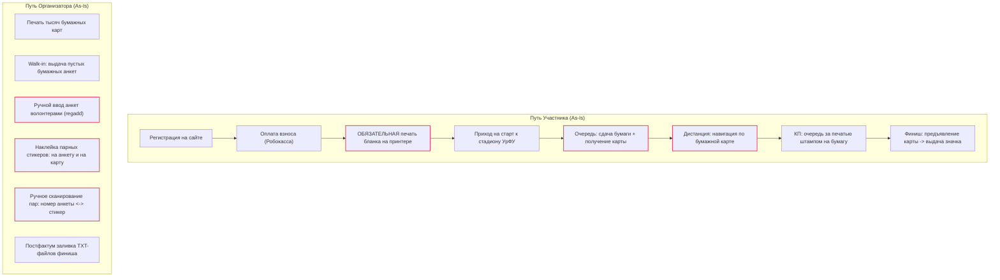
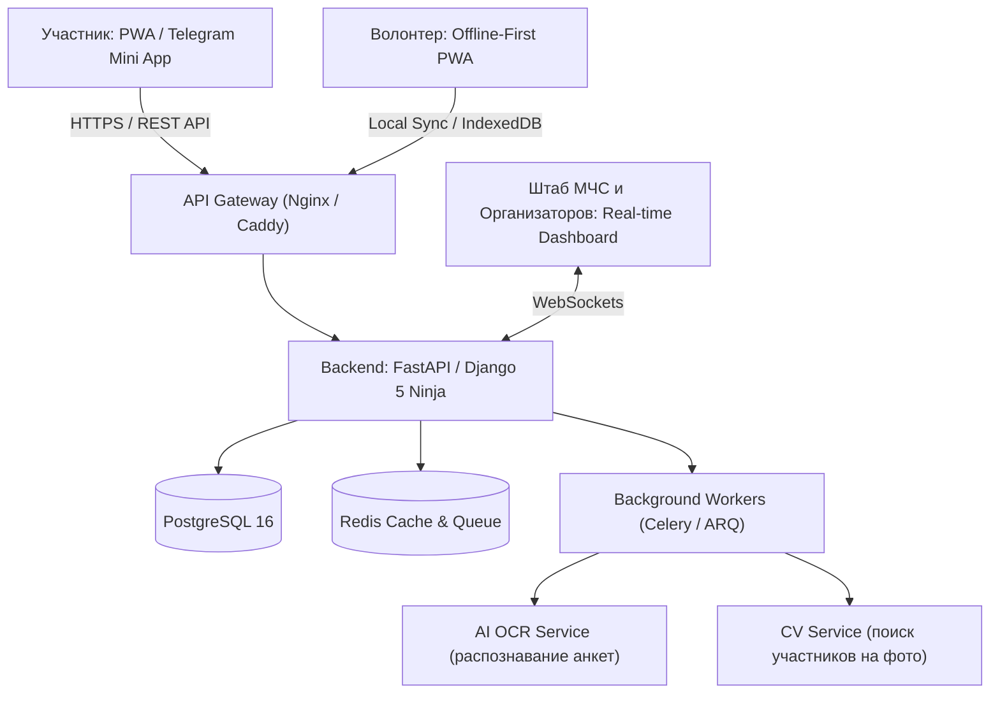

# Комплексный аудит сайта, архитектуры и процессов «Майской прогулки» (mayprogulka.ru)

> **Примечание:** Аудит подготовлен на основе анализа исходного кода (Django-репозиторий `veseloff-mayprogulka`), действующих бизнес-процессов, вводных данных от соорганизатора мероприятия Льва Муравьева и пользовательского опыта участников.

---

## 1. Паспорт проекта и контекст мероприятия

* **Событие:** «Майская прогулка» — традиционное массовое пешеходное мероприятие (проводится ежегодно с 1984 года, организаторы — УрФУ и Федерация спортивного туризма Свердловской области).
* **Масштаб:** от 3 до 6 маршрутов протяженностью от 10 до 70 км, аудитория — от 7 000 до 15 000+ участников в день старта.
* **Ключевые бизнес-цели системы:**
  1. Онлайн-регистрация и прием взносов (учет модели «1 плательщик -> N участников»).
  2. Выдача стартовых пакетов и сопоставление участников с номерами карт.
  3. Отслеживание участников на контрольных пунктах (КП) и обеспечение безопасности (фиксация того, что все благополучно финишировали).
  4. Предоставление оперативной статистики и инфографики в реальном времени.

---

## 2. Технический аудит кодовой базы и инфраструктуры

### 2.1. Анализ стека и жизненного цикла компонентов (EOL)

| Компонент | Текущая версия в коде | Статус жизненного цикла | Риски |
| :--- | :--- | :--- | :--- |
| **Django** | `3.2.12` | **End-of-Life (EOL)** в апреле 2024 г. | Отсутствие патчей безопасности, нет поддержки асинхронных представлений (async views/ORM), нет поддержки Python 3.12+. |
| **PostgreSQL** | `10.14` (в Dockerfile) | **End-of-Life (EOL)** в ноябре 2022 г. | Критически устаревшая СУБД; отсутствие современных функций оптимизации JSONB, параллелизма и индексов. |
| **Python Barcode / QR** | `python-barcode 0.15.1`, `qrcode 7.3.1` | Рабочие | Генерация изображений на лету через синхронный I/O диска. |
| **Экспорт** | `xlsxwriter 3.0.3`, `openpyxl 3.1.5` | Рабочие | Генерация тяжелых отчетов выполняется в главном веб-потоке без фоновых очередей. |

### 2.2. Архитектура приложения
Текущая система построена как **классический монолит с серверным рендерингом (SSR)** на стандартных Django-шаблонах (`mayapp/templates/`). 
* **Отсутствие API:** В проекте нет ни REST API, ни GraphQL. Любое внешнее взаимодействие (мобильное приложение, внешний сканер, виджет для соцсетей) невозможно без дописывания слоя сериализации.
* **Привязка к годам в статических файлах:** В статике обнаружены файлы `2025.css`, `2025.js`, `promo2025.png`. Каждый сезон логика верстки и таймеров дублируется и хардкодится вручную вместо универсальной параметризации из панели управления.

### 2.3. Инфраструктура и деплой
В репозитории отсутствует `docker-compose.yml`. В `README.md` регламентирован ручной запуск контейнеров с фиксированными статическими IP:
```bash
docker network create --subnet=172.21.0.0/29 mayprogulka_network
docker run ... --ip 172.21.0.2 postgres:10.14
docker run ... --ip 172.21.0.3 mayprogulka_web:latest
```
* **Деплой через alias:** Обновление продакшена настроено через bash-алиас `remay`, который стягивает мастер-ветку и перезапускает контейнер:
  ```bash
  alias remay='cd /home/mayprogulka && git pull && docker build ... && docker stop ... && docker rm ... && docker run ...'
  ```
  Это приводит к простоям (downtime), чревато падением сервиса прямо во время массовой регистрации и делает невозможным плавный откат (blue-green deployment).

### 2.4. Анализ безопасности и целостности данных

> ⚠️ **Критическая уязвимость: Принудительное понижение регистра паролей (Lowercase Passwords)**
> В `views.py` (строки 66, 101) при аутентификации и регистрации пароль принудительно преобразуется к нижнему регистру:
> ```python
> password = auth_form.cleaned_data['password'].lower()
> ```
> **Последствия:** Искусственное ослабление стойкости паролей, грубое нарушение стандартов криптографической защиты (OWASP, NIST), поломка работы менеджеров паролей и недоумение пользователей при вводе сложных паролей с заглавными буквами.

* **Утечка секретного ключа:** В `settings.py` (строка 11) значение `SECRET_KEY = 'django-insecure-f@wk$jlbt...'` захардкожено прямо в кодовой базе.
* **Неограниченный хостинг:** `ALLOWED_HOSTS = ['*']`, что открывает вектор для атак отравления заголовка Host (Host Header Injection).
* **Race Conditions и массовые дубликаты оплат:** В коде отсутствует механизм распределенных блокировок при оформлении платежа. Если пользователь нажимает кнопку несколько раз, создаются дублирующие записи. В служебном скрипте `fix_doubles.py` зафиксированы десятки инцидентов, когда у одного участника возникало до 10 дублирующих регистраций:
  ```python
  [11940, 11941, 11945, 11946, 11947, 11951, 11959, 11960, 11965, 189]
  ```
* **Потеря ведущих нулей в штрихкодах:** Скрипт `fix_zeros.py` был написан для экстренного исправления рассинхронизации номеров карт и анкет, так как штрихкод-сканеры и Excel обрезали лидирующие нули строковых идентификаторов.

### 2.5. Главная архитектурная проблема: Полное отсутствие модели КП в базе данных

В модели `Reg` (Регистрация) есть только два булевых флага:
```python
started = models.BooleanField('Стартовал', default=False)
finished = models.BooleanField('Финишировал', default=False)
```
**В коде вообще нет моделей `Checkpoint`, `CheckpointPass` или журнала прохождения промежуточных точек!** 
На промежуточных КП отметки ставятся резиновыми штампами на бумажную карту. Если волонтеры на КП собирают штрихкоды сканерами, эти данные накапливаются локально в текстовые файлы и загружаются в систему постфактум пачкой через форму `upload_finish_time.html`. 

Реального онлайн-трекинга участников на дистанции в существующей системе **не существует**.

---

## 3. Аудит пользовательского пути (CJM) и операционных узких мест



### 3.1. Узкие места для Участника:
1. **Необходимость распечатки бумажного бланка:** Участник обязан найти принтер, распечатать бланк и поставить физическую подпись об ответственности и ПДн. Для молодой аудитории это огромный барьер.
2. **Отсутствие цифровой навигации:** Участникам выдается исключительно бумажная карта. Нет готовых GPX-треков, интеграции с Яндекс Картами, 2ГИС или навигатором. Человек идет «по ориентирам», повышается риск заблудиться в лесу.
3. **Очереди на старте и КП:** Из-за ручной проверки распечатанных бланков, наклеивания стикеров и ручной постановки печатей образуются «пробки», особенно на популярных дистанциях (17 и 33 км).
4. **Низкая вовлеченность на финише:** «Показал печати, дали значок, пошел домой». Нет фиксации личного рекорда, нет цифрового диплома, статистика скрыта от глаз.

### 3.2. Узкие места для Организатора:
1. **Процесс «стикерования» и сопоставления:** 
   Волонтер берет пару одинаковых штрихкод-стикеров. Один клеит на бумажную анкету, второй — на карту. Затем пачки анкет сканируются ручным сканером для связывания `[ID участника <-> Номер карты]`. Это тысячи часов монотонной работы и постоянный источник ошибок.
2. **Ручной ввод данных на старте:** Для тех, кто пришел без онлайн-оплаты, раздаются бумажные бланки. Волонтеры сидят в палатке и судорожно вбивают неразборчивый почерк в форму `regadd`.
3. **Слепая зона в лесу:** Волонтеры на отдаленных КП не имеют стабильного 3G/4G интернета. Текущий сайт требует постоянного подключения к серверу: если интернет пропадает, веб-страница сканера зависает. В результате организаторы не знают в реальном времени, сколько людей сейчас находится между КП-2 и КП-3.

---

## 4. Рекомендации по модернизации архитектуры (To-Be)

### 4.1. Вердикт: Greenfield (разработка альтернативной версии с нуля)
Попытка рефакторить монолит на Django 3.2 экономически нецелесообразна:
* Логика системы пронизана устаревшими концепциями (бумажные бланки, парные стикеры, серверный рендеринг).
* Переход на современные мобильные сценарии участников и волонтеров требует полноценного REST/WebSocket API и клиентских приложений.

### 4.2. Целевая архитектурная схема



### 4.3. Ключевые изменения бизнес-процесса To-Be:
1. **Полный отказ от обязательной бумаги:**
   * Согласие с правилами и обработка персональных данных по 152-ФЗ подписываются простой электронной подписью (SMS-код или подтвержденная оферта в личном кабинете при оплате).
   * Участник получает **электронный билет / QR-код** прямо в Telegram, Apple Wallet / Google Wallet или на экран смартфона.
2. **Ликвидация процедуры сопоставления стикеров:**
   * QR-код участника уникален изначально. При выдаче карты волонтер считывает QR телефоном за 0.5 секунды и выдает карту (номер которой уже привязан в системе, либо карта вообще обезличена, а номер участника — это его цифровой ID).
3. **Offline-first PWA для волонтеров на КП:**
   * Специализированное веб-приложение для смартфонов волонтеров.
   * Приложение кеширует список участников в IndexedDB и считывает QR камерой смартфона **без доступа к сети**.
   * Как только смартфон ловит хотя бы слабый сигнал сети (Edge/3G), накопленные пакеты отметок синхронизируются с центральной базой данных.
4. **Публичный live-дэшборд:**
   * Экраны на финише и страница на сайте показывают живую динамику: сколько людей вышло на старт, сколько находится на каждом сегменте трассы, сколько финишировало.

---

## 5. Вопросы, требующие уточнения у заказчика (Open Questions)

Для успешного проектирования и разработки альтернативной версии системы команде необходимо согласовать с заказчиком (Львом Муравьевым и оргкомитетом УрФУ) ряд ключевых регламентных, операционных и технических развилок:

### 5.1. Юридические и регламентные вопросы (152-ФЗ и ответственность)
1. **Отказ от бумажной расписки об ответственности:**
   * *Вопрос:* Готовы ли юристы УрФУ и Федерации спортивного туризма признать согласие с правилами (отсутствие противопоказаний, пожарная безопасность, ответственность за жизнь/здоровье, согласие на обработку ПДн) через **публичную оферту и электронный акцепт** (галочка в личном кабинете при оплате с фиксацией IP, даты и времени)?
   * *Почему это важно:* Если регламент по-прежнему жестко требует физическую «мокрую» подпись ручкой на бумаге, то полностью избавиться от печати бланков не удастся (придется делать гибридный сценарий со сканированием подписанных расписок через OCR).
2. **Регистрация несовершеннолетних участников:**
   * *Вопрос:* Как юридически оформляется ответственность за детей (до 14 и до 18 лет)?
   * *Уточнение:* Достаточно ли того, что родитель регистрирует ребенка из своего аккаунта и акцептует оферту законного представителя онлайн, или требуется отдельное письменное согласие?

### 5.2. Процедура идентификации и отказ от «парных стикеров»
3. **Отказ от наклеек и связки «анкета <-> стикер»:**
   * *Вопрос:* Готов ли оргкомитет перейти на схему, где у участника есть **единый цифровой QR-код**, а бумажная карта выдается обезличенной (или с заранее напечатанным типографским штрихкодом, который «привязывается» сканированием за 1 секунду при выдаче)?
   * *Уточнение:* Планируется ли сохранять физический номер участника (например, нагрудный номерок/наклейку на одежду) для визуального контроля маршалами на дистанции?
4. **Резервные сценарии на финише:**
   * *Вопрос:* Как поступать волонтерам на финише, если у участника на 50-километровом маршруте сел телефон или он потерял бумажную карту? 
   * *Предложение:* Предусмотреть быстрый поиск по ФИО / номеру телефона в PWA-приложении волонтера для подтверждения финиша и выдачи памятного значка.

### 5.3. Инфраструктура на дистанции и контрольных пунктах (КП)
5. **Оборудование волонтеров на КП:**
   * *Вопрос:* На каких устройствах будут работать волонтеры на лесных КП? Будут ли использоваться личные смартфоны волонтеров (BYOD) или оргкомитет централизованно выдает дежурные смартфоны/планшеты?
   * *Уточнение:* Будет ли у волонтеров доступ к пауэрбанкам для непрерывного сканирования в течение 8–12 часов?
6. **Качество сотовой связи на контрольных пунктах:**
   * *Вопрос:* Известны ли организаторам конкретные «мертвые зоны» сотовой связи на маршрутах текущего года (например, в районе Жулановского пруда или лесных кордонов)? 
   * *Влияние на архитектуру:* Это определит критичность Offline-first синхронизации (накопление отметок в IndexedDB с последующей отправкой пачками при появлении сети).
7. **Формат учета на КП:**
   * *Вопрос:* Достаточно ли фиксировать только один факт прохождения КП (отметка «Был на КП-N»), или требуется фиксировать время входа и время выхода (если на КП организован пункт питания/активности)?

### 5.4. Регистрация на месте в день старта (Walk-in)
8. **Доля участников без предварительной регистрации:**
   * *Вопрос:* Каков реальный процент участников, приходящих регистрироваться на стадион без предварительной оплаты на сайте (5%, 15%, 30%)?
   * *Предложение:* Можно ли сократить очереди walk-in, разместив на стадионе информационные стенды с QR-кодом «Экспресс-регистрация со своего телефона за 1 минуту» через СБП, чтобы 80% людей регистрировались самостоятельно в очереди без участия волонтеров?

### 5.5. Финансы и платежные шлюзы
9. **Платежный провайдер и фискализация (54-ФЗ):**
   * *Вопрос:* Обязательно ли сохранять сервис «Робокасса» (как в текущем Django-коде), или оргкомитет готов подключить прямую оплату через СБП (Система быстрых платежей) / интернет-эквайринг банков-партнеров (например, УБРиР, Сбер, Т-Банк) с меньшей комиссией?
   * *Уточнение:* Требуется ли интеграция с онлайн-кассой для отправки фискальных чеков (согласно 54-ФЗ), или стартовый взнос оформляется как членский/благотворительный сбор общественной организации без чека?

### 5.6. Публикация маршрутов и цифровая навигация
10. **Политика конфиденциальности маршрутов:**
    * *Вопрос:* Когда именно оргкомитет готов публиковать треки (GPX/KML) — заранее (за неделю/две) или строго в день старта?
    * *Контекст:* Если треки публикуются заранее, участники смогут заранее загрузить их в свои навигаторы (Яндекс Карты, 2ГИС, Organic Maps). Если треки держатся в секрете во избежание досрочного прохождения, доступ к ним в приложении должен открываться по таймеру старта.

### 5.7. Зона ответственности команды и инфраструктурный хостинг
11. **Границы разработки фронтенда:**
    * *Вопрос:* Заказчик выразил сомнение: *«если вы сделаете только бэк, как можно будет проверить, что все работает?»*.
    * *Решение:* Команде нужно зафиксировать, что в объем работ входит не только бэкенд, но и **полноценный пользовательский интерфейс** (веб-кабинет участника + мобильное PWA волонтера-сканера + веб-страница аналитики для штаба).
12. **Хостинг и сопровождение в день старта:**
    * *Вопрос:* Где будет развертываться серверная часть — на серверах дирекции информационных технологий УрФУ, на коммерческом VDS оргкомитета (Selectel / Timeweb / VK Cloud) или на ресурсах команды разработки? Кто будет дежурить как системный администратор в день старта?

